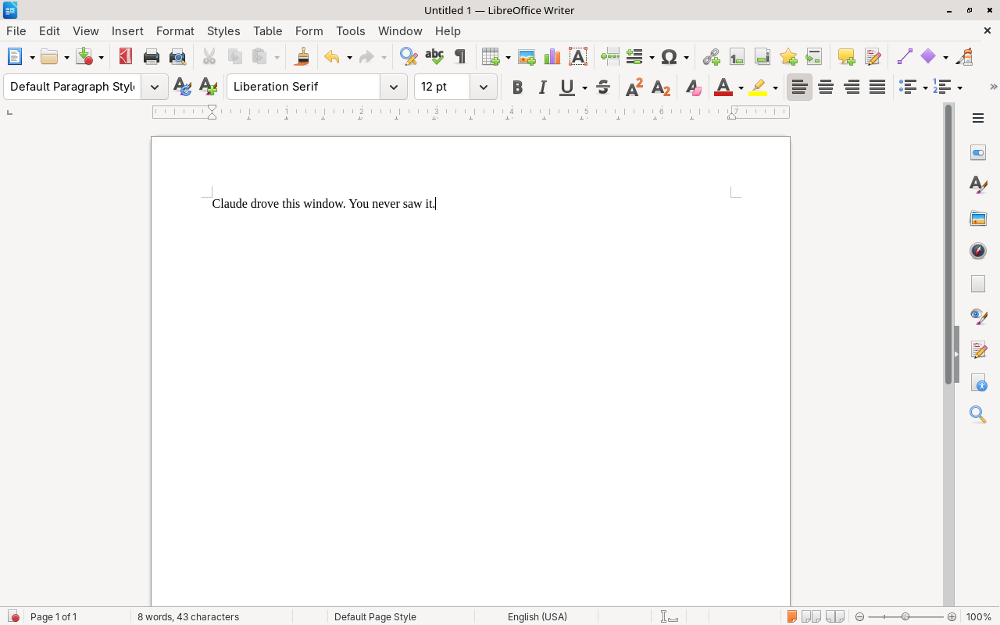

# wbox

**Run a desktop app in a box of its own — offscreen, isolated from your desktop — and drive it: click, type, screenshot, film, even listen.**

wbox gives one app its own display server: a nested Wayland compositor on Linux (labwc, cage, weston, or GNOME's mutter), Windows Sandbox on Windows. Input goes to that box's own seat, screenshots come from its own output, and with `headless: true` nothing is ever drawn on your screen. Your mouse, your focus, your clipboard and your speakers stay yours.

It is made for the jobs a desktop gets in the way of:

- **GUI test suites and CI** — launch the app headless, drive it, assert on pixels, keep the screenshots;
- **reproducing a bug under a given desktop** — the same app under labwc, cage, weston or mutter (GNOME), on a GPU or in software;
- **screenshot tours and recordings** — frames, gifs, and which frames changed;
- **AI agents** — an MCP server exposes the same box to Claude or any MCP client.



*LibreOffice Writer, launched and typed into through wbox — captured with `headless: true`, so this window never rendered on anyone's desktop.*

## Why a box, and not desktop automation?

| | wbox | Desktop automation (xdotool, computer-use servers) |
|---|---|---|
| **Isolated from your desktop** | Yes — its own compositor, its own seat | No — your screen and your input |
| **Runs in the background** | Yes — keep working while it drives | No — it owns your mouse and focus |
| **Offscreen / headless** | Yes — `headless: true`, nothing renders | Rarely |
| **Can the app see your screen?** | No | Yes — everything you have open |
| **Can it read your clipboard?** | Only if you let it (`clipboard_bridge`) | Yes |
| **Does its sound reach your speakers?** | Not headless (`audio: null`), or recorded (`capture`) | Yes |
| **Safe for CI** | Yes | No |

## Three ways to drive a box

### From Python — tests, scripts, CI

```python
import time
from pathlib import Path
from wbox.server import build_compositor

box = build_compositor({"compositor": "labwc", "headless": True,
                        "screen": "1024x700", "keyboard_layout": "us"})
box.state.screenshot_dir = Path("shots")
box.launch(["zenity", "--entry", "--text", "Your name?"], {})
box.type_text("Hello from wbox")
time.sleep(0.3)                      # let the app draw the last keystroke
print(box.screenshot("entry"))       # {'path': 'shots/entry.png', ...}
box.stop()
```

Every tool below is a method of the box, taking the same arguments and returning the same dict. wbox's own integration suite (`tests/test_integration.py`) drives its boxes this way.

### From an AI agent — MCP

```bash
cd my-project/
wboxr init --register      # wbox/config.yaml + an entry in .mcp.json
```

Then ask: *"Open Writer, type 'Hello World', and show me a screenshot."* The agent calls `launch`, `type_text` and `screenshot` itself. [End to end](#end-to-end-with-mcp) below shows the files this writes.

### On a shared machine — with mcu

GUI tests want a machine that is not your laptop: a GPU, a clean Fedora image, a queue. [**mcu**](https://github.com/quazardous/mcu) turns one Linux box into a shared job box for several projects and agents, each with its SSH key, its rootless containers and its share of threads, memory and GPUs. It pairs naturally with wbox: a job starts a headless wbox session inside its container, drives the app, and leaves the screenshots in the job's output. mcu's guide has [a ready-made wbox recipe](https://github.com/quazardous/mcu/blob/main/docs/USING.md#running-a-gui-app-headless-wbox) (labwc headless, on the iGPU or an NVIDIA card), and wbox's own backends are tested on such a box.

## Install

```bash
# Linux
curl -sSL https://raw.githubusercontent.com/quazardous/wbox-mcp/main/setup.sh | bash

# Windows
irm https://raw.githubusercontent.com/quazardous/wbox-mcp/main/setup.ps1 | iex
```

On Windows, read [docs/windows.md](https://github.com/quazardous/wbox-mcp/blob/main/docs/windows.md) first — isolation there comes from Windows Sandbox (`sandbox:` in config.yaml; Pro, Enterprise or Education), which the installer turns on, asking for admin rights; without it the app runs on your desktop. The installer sets up Python too if the machine has none.

**What that script does**, so you can decide before running it: it installs the missing system packages through your distro's package manager (`dnf`, `apt` or `pacman`, asking first), clones this repo into `~/.local/share/wbox-mcp`, installs it into a venv there, and symlinks the two commands `wboxr` and `wbox-mcp` into `~/.local/bin`. It touches nothing else and needs `sudo` only for the packages.

**From PyPI**, with the system packages of step 1 below installed first:

```bash
pipx install "wbox-mcp[scenario]"     # or: pip install "wbox-mcp[scenario]"
```

`[scenario]` adds numpy and Pillow, which scenarios and capture masks need;
leave it out for the box alone.

**Manual install**, if you'd rather not pipe a script into a shell:

```bash
# 1. System packages — required
sudo apt install labwc grim xdotool x11-xkb-utils wlr-randr wlrctl
#    ...and optional, for extra compositors and input backends
sudo apt install weston cage xclip wl-clipboard wtype

# 2. wbox itself
git clone https://github.com/quazardous/wbox-mcp.git ~/.local/share/wbox-mcp
cd ~/.local/share/wbox-mcp
python3 -m venv .venv && .venv/bin/pip install -e .
ln -s ~/.local/share/wbox-mcp/.venv/bin/{wboxr,wbox-mcp} ~/.local/bin/
```

Package names differ per distro — `setxkbmap` is `x11-xkb-utils` on Debian/Ubuntu, `setxkbmap` on Fedora, `xorg-setxkbmap` on Arch. The setup script knows the mapping for all three.

## End to end with MCP

`wboxr init` asks a few questions, adapted to your platform, or takes flags:

```bash
wboxr init --name writer --app-command "soffice --writer" --register
```

`wboxr init --register` writes this into your `.mcp.json`:

```json
{
  "mcpServers": {
    "writer": {
      "type": "stdio",
      "command": "/home/you/.local/bin/wbox-mcp",
      "args": ["serve", "/home/you/my-project/wbox/config.yaml"]
    }
  }
}
```

And `wbox/config.yaml` looks like this — the whole minimal form:

```yaml
name: writer
compositor: labwc          # labwc | cage | weston | mutter | win32
screen: "1280x800"
input_backend: hybrid      # hybrid | x11 | wayland
headless: false            # true = runs offscreen, nothing on your desktop
keyboard_layout: us        # pin this on a non-US host, or typing comes out wrong
app:
  command: soffice --writer
```

Then just ask:

> Open Writer, type "Hello World", and show me a screenshot.

The agent calls `launch`, `type_text` and `screenshot` on its own. The window never appears on your desktop if `headless: true`, and never steals your focus either way.

Two settings are worth knowing before you automate a real app:

- **`keyboard_layout`** — input injection assumes US keycode positions. On an AZERTY host without this, `type_text("abc123")` can arrive as `qbc!@#`.
- **`post_launch_keys`** — shortcuts sent once the app has rendered, e.g. `["super+a"]` to maximize it. Slow apps like LibreOffice usually want this plus a longer `timeouts.app_render`.

## Platform features

| Feature | Linux | Windows |
|---------|-------|---------|
| Screenshot | grim (pixel-perfect) | PrintWindow — works behind other windows |
| Keyboard | wbox-keyboard (virtual keyboard) | SendInput (Unicode) / PostMessage |
| Mouse | wbox-pointer (virtual pointer) | SendInput / PostMessage |
| Clipboard | the box's own; a bridge to yours is opt-in | Win32 clipboard API — yours, shared; the sandbox's own with `sandbox:` |
| Window management | wlrctl (list/focus) | Win32 (list/focus, which one is active) |
| Resize display | wlr-randr | Resizes the window: its client area, to the pixel |
| App isolation | Full (nested compositor) | With `sandbox:` (Windows Sandbox); **none** without |
| Background operation | Yes (isolated display) | With `sandbox:`; without, screenshots only — most input takes focus |
| Offscreen / headless | Yes (`headless: true`) | With `sandbox:`, the sandbox's window minimized; ignored without |
| Interferes with host | No | Not with `sandbox:`; without, most clicks move your cursor and take focus |

**Linux** — the app runs inside a nested Wayland compositor (labwc, cage or weston), or in a headless GNOME mutter (`compositor: mutter`, driven through mutter's own remote-desktop and screen-cast interfaces). Full isolation: the app cannot see or interfere with your desktop. Its clipboard is its own unless you turn on `clipboard_bridge`, and headless its sound goes to a private audio server (`audio: null`, or `capture` to record and measure it). Keyboard and mouse are injected through the box's own input devices, so nothing leaks onto your seat.

Set `headless: true` and the nested session runs offscreen — no window on your desktop, while screenshots, clicks and keystrokes keep working exactly the same. Handy for test suites and unattended runs.

**Windows** — the app is driven through Win32 APIs. With `sandbox:` it runs in Windows Sandbox, a throwaway Windows of its own that boots in about 15 seconds: the pointer, keyboard and clipboard wbox uses are the sandbox's, and yours are left alone. Without it, the app runs as a normal process on your desktop: it shares your desktop and your clipboard, and most clicks warp your real mouse cursor and pull the window to the front. Screenshots work even when the window is covered.

Two things are safer than they used to be. `type_text` types the characters and never touches your clipboard. And when the app window can't be brought to the front, `click`, `mouse_move` and key combos refuse and name the window that is in the way, instead of clicking it. Elevated apps remain largely off-limits. [docs/windows.md](https://github.com/quazardous/wbox-mcp/blob/main/docs/windows.md) has what was measured to work, the limitations, and troubleshooting.

## Tools

The same set as MCP tools and as methods of a box in Python:

`launch` · `stop` · `kill` · `screenshot` · `screen_changed` · `record` · `audio` · `click` · `dblclick` · `drag` · `scroll` · `hold` · `type_text` · `key` · `keys` · `press` · `key_down` · `key_up` · `mouse_move` · `get_mouse_position` · `get_size` · `resize` · `list_windows` · `focus_window` · `clipboard_read` · `clipboard_write` · `tail_log` · `clean` · `debug_input`

With `gamepad:` set: `pad_press` · `pad_hold` · `pad_stick` · `pad_trigger` · `pad_script` · `pad_state` · `pad_neutral` · `pad_rumble`

Plus custom script tools via `wboxr tool add` (MCP).

### Driving a game

A game is not a form. Two things differ, and wbox has a setting for each.

**It reads the keyboard once a frame.** `key` sends the press and the release
together, which a text field takes but a game misses: they land between two
frames, and the key is never seen down. Measured with an SDL game polling at
60 fps: ten `key("a")`, ten key-down events, **zero** frames with the key
held. Give the press a duration — `key("a", hold_ms=50)`, or
`key_hold_ms: 50` in config.yaml for every `key` and `keys` — and the same ten
presses are ten. `press(["shift", "w"], 800)` holds keys together (run
forward for 0.8 s); `key_down` / `key_up` keep them held across calls, while
other calls turn the camera or take screenshots.

**It reads a controller, through SDL, not through Wayland.** `gamepad:
xbox360` (or `xboxone`) makes a virtual Xbox pad over `/dev/uinput`, before
the app starts, with the vendor, product, buttons and axes of a real one, so
SDL maps it from its own database like a pad plugged into USB. `pad_script`
plays a timed sequence in one call (`"0.5:a,1:lup/1500,3:lt+rb"`:
`<seconds>:<input>[+<input>...][/<ms>]`), and `pad_rumble` reports the
vibration the game asked for.

```yaml
key_hold_ms: 50
gamepad: xbox360          # or {profile: xboxone, isolate: true}
```

A uinput device belongs to the whole machine, so the box isolates the app in
both directions: it runs under bubblewrap with a `/dev/input` holding the
virtual pad's node and nothing else, and SDL's udev and HIDAPI lookups off.
The app cannot see your real pads, keyboard or mouse; `isolate: false` turns
this off. Other programs on the desktop can still see the virtual pad while
the box runs.

Requires write access to `/dev/uinput`, which most distributions keep for
root:

```bash
echo 'KERNEL=="uinput", GROUP="input", MODE="0660", OPTIONS+="static_node=uinput"' \
  | sudo tee /etc/udev/rules.d/60-wbox-uinput.rules
sudo udevadm control --reload && sudo udevadm trigger /dev/uinput
sudo usermod -aG input $USER     # then log in again
```

That rule lets any program of yours create input devices, not just wbox.
Linux only (labwc, cage, weston), and `bwrap` for the isolation.

`screen_changed` answers whether the display, or a region of it, differs from an earlier screenshot — optionally waiting for it to: an assertion on pixels that a window really moved or a view really changed.

### Seeing what a screenshot cannot show

`record` films the display for a few seconds instead of catching one instant.
A region films several times faster than the full screen, and `during` plays a
drag, a click or a keystroke while the capture runs, so the film and the
gesture need no script to line them up.

It returns the frames and a summary — how many, the interval actually
achieved, and **which frames differ from the one before**. That last one is
what catches a flicker: a value that changes and changes back. Pass
`assemble: "gif"` (or `"mp4"`) to also get a film; the frames are kept either
way, since they are what a per-frame analysis reads.

Not available under weston, which announces no wlr-screencopy for the capture
to read.

On Windows it films the app's window, in Windows Sandbox too — measured there,
17 frames/s for an 800×600 window and 32/s for a 300×200 region — and a
sandbox's film is assembled on the host, where ffmpeg is.

### Scenarios: a run played again, and compared

Driving an app by hand gives one-off pictures. Comparing a fix, two drivers or
two GPUs needs the same run played again and again, its results side by side.
A scenario is that run, written down — [examples/scenario.yaml](https://github.com/quazardous/wbox-mcp/blob/main/examples/scenario.yaml):

```yaml
name: title-screen
config: config.yaml
setup:
  copy: {saves/start.sav: ~/.local/share/game/save.sav}   # put back after the run
  env:  {FRAME_LOG: "{run}/frames.csv"}
masks:
  clock: [{rect: ["85%", "2%", "13%", "6%"]}]             # pixels or %
  water: [{image: masks/water.png}]                       # black = ignored
  menu:  [{only: [480, 545, 320, 85]}]                    # this alone is compared
default_mask: [clock]
steps:
  - wait: {log: "renderer ready", timeout: 120}           # the app's output
  - wait: {stable: 2.0, timeout: 60}                      # the screen holds still
  - wait: {match: refs/title.png, threshold: 0.05}        # looks like a reference
  - checkpoint: title
  - pad_script: "0:a,1.5:a"
  - record: {seconds: 5, name: walk, during: {type: pad_script, script: "0:lup/5000"}}
  - checkpoint: {name: walked, mask: [clock, water]}
metrics:
  - {name: frametime, file: "{run}/frames.csv", column: ms, unit: ms}
```

```bash
wboxr run title-screen.yaml --repeat 5        # runs/title-screen/<date>/ ×5
wboxr compare runs/title-screen/*/            # against the first
wboxr mask suggest runs/title-screen/*/       # what changes between them
```

**Why it waits instead of sleeping.** Loading takes 4 s on one run and 6 s on
the next: inputs at fixed times land on different frames, and captures at
"t = 10 s" show different things. Each `wait` is a point where every run is
back in step, and the checkpoints are taken at those points. When the app can
count its own frames (an input script timed in game frames), let it: that is
deterministic where wbox, outside, can only wait.

**Masks.** A clock, particles, water: some pixels are never the same twice. A
mask names zones to ignore, and applies everywhere pixels are compared — a
`stable` wait would otherwise never end on a ticking clock. An `only` zone
works the other way: everything outside it is ignored, for a menu over a
background video that never holds still. Captures are kept
raw, so a mask can change and old runs be compared again. `mask suggest`
finds the zones that differ between runs at the same checkpoint.

**What a run keeps.** `manifest.json`: wbox, the kernel, the CPU, each GPU and
its driver (from `vulkaninfo`), hashes of the scenario, the config, the setup
files and the masks, and the output of any `manifest:` commands (the app's
version). `results.json`: every step and its duration, when each checkpoint
was reached, the metrics. `checkpoints/*.png`, `app.log`, the `collect:`ed
files. `compare` reports, per checkpoint, the share of pixels that differ
outside the mask and the time it was reached, writes diff images (differences
in red, masked zones hatched), puts the metrics side by side, and lists what
differs between the manifests: a different driver, or a scenario edited
between two runs.

Steps are the box's tools with the same arguments (`key`, `press`,
`pad_script`, `click`, ...) plus `wait`, `checkpoint`, `record` and `sleep`.
The same through MCP: `run_scenario`, `compare_runs`, `suggest_mask`. Needs
numpy and Pillow: `pip install "wbox-mcp[scenario]"`.

### When something goes wrong

- **`stop`** — graceful shutdown: SIGTERM, then SIGKILL after `timeouts.stop`.
- **`kill`** — force-kills every compositor and app process and clears the recorded state. This is the one to reach for if a session died mid-launch and left a stale socket behind; the next `launch` also cleans stale sockets on its own.
- **`clean`** — housekeeping only: removes logs and screenshots. It does not kill anything.
- **`tail_log`** — read the app's log without leaving the conversation.

## Documentation

- [docs/usage.md](https://github.com/quazardous/wbox-mcp/blob/main/docs/usage.md) — CLI flags, config.yaml reference, MCP tools details, requirements
- [docs/backends.md](https://github.com/quazardous/wbox-mcp/blob/main/docs/backends.md) — compositor comparison, input backends
- [docs/matrix.md](https://github.com/quazardous/wbox-mcp/blob/main/docs/matrix.md) — what's verified to work on Linux, per compositor and backend
- [docs/windows.md](https://github.com/quazardous/wbox-mcp/blob/main/docs/windows.md) — the Windows backend: install, input routing, measured status, limitations, troubleshooting

## License

MIT — see [LICENSE](https://github.com/quazardous/wbox-mcp/blob/main/LICENSE).
